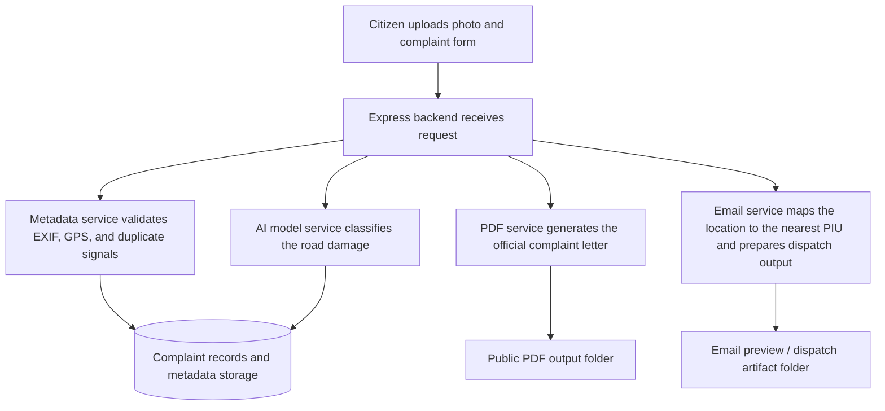

# Road Safety Complaint Portal

A full-stack project for collecting road-defect complaints, validating uploaded evidence, classifying surface damage, generating formal complaint documents, and routing complaints to the relevant PIU office.

## Workflow



## Project Structure

```text
Road_safety/
├── Backend/                  # API backend modules and service layer
├── frontend/                 # Frontend application source
├── public/                   # Static client assets and runtime output folders
├── services/                 # Core backend business logic
│   ├── metadataService.js    # EXIF/GPS validation, originality checks, and duplicate detection
│   ├── modelService.js       # AI classification integration point
│   ├── pdfService.js         # PDF document generation
│   └── emailService.js       # PIU routing and notification preview
├── data/                     # Complaint / dataset-related data files
├── Database/                 # Schema and persistence-related resources
├── Dataset/                  # Training and sample datasets
├── server.js                 # Main Express entry point
├── package.json              # Node runtime and dependency metadata
└── requirements.txt          # Python-related dependency metadata
```

## How the Application Runs

1. Install dependencies:

   ```bash
   npm install
   ```

2. Start the server:

   ```bash
   npm start
   ```

3. Open the app in the browser:

   ```text
   http://localhost:3000
   ```

## Notes

- The frontend is responsible for collecting complaint details and evidence uploads.
- The backend validates uploaded content, records complaint metadata, and prepares downstream outputs.
- The generated PDFs and email previews are stored in the corresponding public output folders for review.

