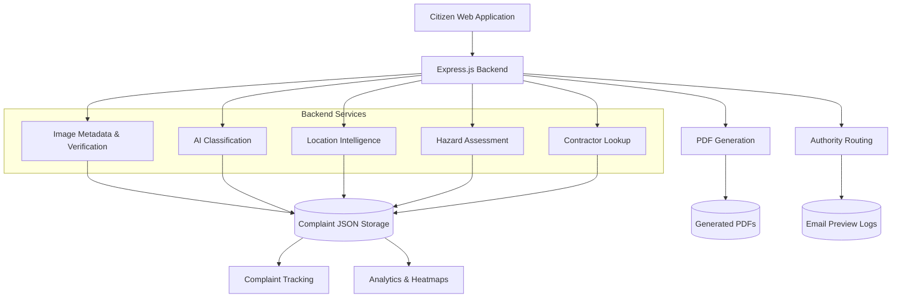

# FixMyRoad 

### AI-Powered Road Defect Classification & Intelligent Complaint Routing

**Detect. Report. Route. Resolve.**

FixMyRoad is an AI-powered civic technology platform designed to streamline road defect reporting and complaint management. It enables citizens to submit road-related complaints with photographic and location evidence, uses machine learning to classify pavement conditions, verifies image metadata, identifies relevant road context, and prepares complaints for routing to the appropriate road maintenance authority.

The platform integrates computer vision, image metadata analysis, geospatial intelligence, rule-based hazard assessment, automated PDF generation, and complaint analytics into a modular web application.

## 1. Key Features

### Citizen Complaint Submission
- Submit road defect complaints with image uploads and descriptions.
- Supports mobile camera capture and gallery uploads.
- Captures browser GPS coordinates when location permission is granted.
- Supports manual road and location details.
- Generates unique complaint reference IDs.

### Image Authenticity & Verification
- Extracts EXIF metadata, including GPS coordinates, capture timestamps, device information, and image resolution.
- Computes SHA-256 hashes to identify exact duplicate images.
- Uses a lightweight byte-sampling fingerprint to flag potential image similarities.
- Checks photo freshness against a configurable time threshold.
- Compares image GPS coordinates with browser-submitted location.
- Identifies potential editing indicators from available EXIF software metadata.
- Generates an authenticity score and verification flags.

*Note: These checks provide verification signals, not cryptographic proof that an image is genuine.*

### AI-Based Pavement Classification
- Integrates a trained YOLOv8 classification model through a Python inference bridge.
- Supports local PyTorch `.pt` model inference.
- Supports an optional external model API.
- Provides a mock classification fallback for development and demonstration.
- Returns predicted road condition, class confidence, severity suggestions, and inference metadata.

### Location Intelligence
- Uses OpenStreetMap Nominatim for reverse geocoding.
- Resolves available road names, areas, cities, districts, and states from coordinates.
- Applies heuristic road-type classification.
- Identifies a suggested responsible authority based on the resolved road category.
- Supports configurable reverse-geocoding endpoints and request timeouts.

### Intelligent Complaint Routing
- Maintains a predefined NHAI Project Implementation Unit (PIU) directory.
- Calculates geographical distances to identify the nearest configured PIU.
- Supports road-category-based authority suggestions.
- Includes local contractor lookup using geographical coordinates.
- Generates routing information and dispatch previews for complaint records.

### Hazard Assessment
- Calculates a rule-based hazard index using complaint category, description keywords, and image verification score.
- Produces severity and urgency suggestions.
- Maintains additional contractor and road maintenance information where available.

### Complaint Management & Analytics
- Generates unique complaint IDs.
- Stores complaint information and verification results.
- Provides complaint lookup and tracking.
- Offers dashboard statistics and category-wise complaint distribution.
- Provides geospatial complaint records for heatmap visualization.
- Maintains local email activity logs.

### PDF Documentation
- Automatically generates PDF complaint letters using PDFKit.
- Includes complaint reference information, classification results, GPS coordinates, verification status, and PIU information.
- Stores generated documents under `public/pdfs/`.

### Progressive Web App
- Includes a web application manifest.
- Supports installation on compatible devices.
- Uses a service worker for caching static application assets.
- Provides offline access to cached application resources.

*Offline caching does not provide offline complaint submission, AI inference, or API functionality.*

---

## 2. Technology Stack

| Layer | Technologies |
|---|---|
| Backend | Node.js, Express.js |
| Frontend | HTML, CSS, JavaScript |
| Machine Learning | Python, Ultralytics YOLOv8, PyTorch |
| Model Integration | Python subprocess bridge, optional HTTP inference API |
| Image Processing & Metadata | ExifReader, Node.js Crypto |
| Geospatial Services | OpenStreetMap, Nominatim, GPS, Haversine distance calculation |
| File Uploads | Multer |
| PDF Generation | PDFKit |
| Email Preview & Logging | Nodemailer dependency, HTML previews, JSON activity logs |
| Data Persistence | JSON file-based storage |
| PWA | Web App Manifest, Service Worker |
| Containerization | Docker |

---

## 3. System Architecture

FixMyRoad follows a modular service-oriented backend structure. Express.js coordinates complaint processing and delegates specialized tasks to independent service modules.



### Complaint Processing Workflow

1. A citizen uploads a road image and provides complaint details.
2. The backend validates the request and processes the uploaded image.
3. EXIF metadata, image hashes, timestamps, and available GPS information are analyzed.
4. Exact duplicate submissions are rejected.
5. The AI classification service analyzes the road image.
6. Location information is resolved using image GPS or browser GPS.
7. Road context and a suggested authority are determined.
8. The hazard index and contractor information are calculated.
9. A structured complaint record is generated.
10. A PDF complaint letter and email preview are created.
11. Complaint details are persisted in local JSON storage.
12. The complaint becomes available through tracking and analytics endpoints.

---

## 4. Core Backend Modules

| File | Responsibility |
|---|---|
| `server.js` | Express application, middleware, upload handling, API endpoints, complaint workflow, and data persistence. |
| `services/metadataService.js` | EXIF extraction, SHA-256 hashing, duplicate checks, GPS consistency checks, image freshness checks, and authenticity scoring. |
| `services/modelService.js` | Local PyTorch inference, external model API integration, response normalization, and mock classification fallback. |
| `services/pavementClassifier.py` | Python inference bridge that loads YOLOv8 classification weights and returns classification probabilities. |
| `services/locationService.js` | Reverse geocoding, road-type heuristics, road context resolution, and authority suggestions. |
| `services/emailService.js` | Nearest PIU lookup, HTML email preview generation, and email activity logging. |
| `services/pdfService.js` | PDF complaint letter generation using PDFKit. |
| `services/contractService.js` | Nearest contractor lookup and rule-based hazard index calculation. |
| `public/js/app.js` | Frontend complaint submission, location capture, AI integration, dashboard functionality, and heatmap interactions. |

---

## 5. AI Classification Pipeline

FixMyRoad integrates a trained YOLOv8 classification model through a Python bridge.

### Inference Architecture

```text
Uploaded Road Image
        |
        v
Express.js Model Service
        |
        v
Python Classification Bridge
        |
        v
Ultralytics YOLOv8 Classifier
        |
        v
PyTorch Model Weights
        |
        v
Classification Probabilities
        |
        v
Normalized Model Response
        |
        v
Complaint Enrichment
```

### Model Integration Modes

**1. Local Model Inference**

- Loads the `.pt` model weights.
- Invokes the Python classification script from Node.js.
- Processes the image using Ultralytics.
- Returns the predicted class and confidence scores.

**2. External Model API**

- Sends the uploaded image to a configurable HTTP inference endpoint.
- Supports timeout handling and response normalization.

**3. Mock Classification**

- Provides simulated classification responses when real inference is unavailable.
- Intended for development and demonstration, not actual road condition assessment.

### Model Output

The normalized response can contain:

- `detected`
- `primaryClass`
- `defectCategory`
- `displayName`
- `confidence`
- `confidenceScore`
- `severity`
- `severityLevel`
- `detections`
- `inferenceTimeMs`
- `source`

**Important:** The local Python bridge uses classification probabilities and does not generate object-detection bounding boxes. Any bounding-box-like results from the mock classifier are simulated, not predictions from the classification model.

AI-generated severity and complaint enrichment are suggestions and should not replace physical road inspections.

---

## 6. Image Authenticity & Verification

The metadata service performs several checks on uploaded images.

| Verification | Implementation |
|---|---|
| Exact duplicate detection | SHA-256 file hash comparison |
| Potential similarity | Lightweight byte-sampling fingerprint |
| GPS extraction | EXIF GPS metadata |
| Capture timestamp | EXIF date and time fields |
| Photo freshness | Configurable time threshold |
| Location consistency | Haversine distance between image and browser GPS |
| Editing indicators | EXIF software metadata |
| Image properties | Resolution, orientation, and file size |

### Configurable Verification Thresholds

- `PHOTO_FRESHNESS_HOURS`: Default 48 hours.
- `LOCATION_MISMATCH_KM`: Default 2 kilometres.

The verification service calculates a score and records relevant flags.

These checks have limitations:

- EXIF metadata can be modified or removed.
- Screenshots and edited images may not retain useful metadata.
- Missing metadata does not necessarily mean an image is fraudulent.
- The lightweight fingerprint is not a robust perceptual image similarity algorithm.

Verification results should therefore be interpreted as indicators for review rather than definitive authenticity judgments.

---

## 7. Location Intelligence & Authority Routing

The location service uses OpenStreetMap Nominatim reverse geocoding to obtain available address information from geographical coordinates.

### Road Classification

The current implementation uses address fields and textual heuristics to classify roads into categories such as:

- National Highway
- State Highway
- Urban Road
- Rural Road
- Service Road
- District Road

### Authority Selection

The current authority selection logic provides suggested routing based on road classification.

| Road Category | Suggested Authority |
|---|---|
| National Highway | Nearest configured NHAI PIU |
| State Highway | State Highways Department |
| Urban Road | Municipal Road Maintenance Cell |
| Service Road | Municipal Road Maintenance Cell |
| Rural Road | Local Panchayat Road Works |
| District Road / Other | District Road Maintenance Office |

### NHAI PIU Lookup

The PIU service maintains a predefined list of geographical coordinates and contact information.

It calculates the Haversine distance between the complaint coordinates and configured PIUs and selects the nearest entry.

**Routing limitations:**

- Road classification is heuristic rather than based on authoritative road ownership records.
- The PIU directory is a predefined demonstration dataset.
- Some authority email addresses are placeholders.
- The nearest PIU is not necessarily the legally responsible authority.
- Actual government grievance submission and acknowledgement are not integrated.

The routing results should be treated as suggested destinations pending verification.

---

## 8. Hazard Assessment & Contractor Lookup

The contractor service provides two additional capabilities.

### Hazard Index

A rule-based hazard index is calculated using:

- Complaint category.
- Keywords in the citizen's description.
- Image metadata verification score.

The resulting assessment provides a preliminary indication of potential road safety risk.

It is not a physically calibrated engineering severity measurement.

### Contractor Lookup

The service reads contractor records from the local contracts JSON file and calculates geographical distances to identify a nearby configured contractor.

It uses a configurable geographical range and a general fallback contract when available.

Contractor information is dependent on the locally maintained dataset and is not a live government contractor registry.

---

## 9. Complaint Data Model

Each submitted complaint is stored as a structured JSON record.

The following represents the principal fields used by the current backend:

```json
{
  "id": "NHAI-2026-XXXXXXXX",
  "category": "pothole",
  "description": "Road surface deterioration",
  "imageUrl": "/uploads/complaint-image.jpg",
  "sha256": "",
  "fingerprint": "",
  "imageMetadata": {},
  "authenticityScore": 0,
  "verificationFlags": [],
  "metadataResults": {},
  "modelResults": {},
  "aiEnrichment": {},
  "roadContext": {},
  "roadName": "",
  "roadType": "",
  "authority": {},
  "area": "",
  "district": "",
  "state": "",
  "landmark": "",
  "directionOfTravel": "",
  "severity": "",
  "estimatedDimensions": "",
  "trafficImpact": "",
  "safetyRisk": "",
  "piuEmailMapping": {},
  "contractorDetails": {},
  "hazardResults": {},
  "routingStatus": "",
  "status": "",
  "createdAt": "",
  "pdfUrl": "",
  "emailDispatch": {}
}
```

Additional fields and nested properties are maintained by individual services.

---

## 10. API Reference

All application API endpoints are served through the Express.js backend.

### Complaint Management

| Method | Endpoint | Description |
|---|---|---|
| POST | `/api/complaints` | Submit a complaint with an image and complaint details. |
| GET | `/api/complaints` | Retrieve all stored complaints. |
| GET | `/api/complaints/:id` | Retrieve a complaint using its reference ID. |
| GET | `/api/complaints/stats` | Retrieve complaint statistics. |
| GET | `/api/complaints/geo` | Retrieve geospatial complaint records for heatmaps. |

### AI Classification

| Method | Endpoint | Description |
|---|---|---|
| POST | `/api/model/analyze` | Analyze an uploaded image and return model results with enrichment suggestions. |

**Request:** `multipart/form-data`, with an image field named `image`.

### Location Intelligence

| Method | Endpoint | Description |
|---|---|---|
| GET | `/api/location/context?lat=&lon=` | Resolve road context and suggested authority for coordinates. |
| GET | `/api/location/options` | Retrieve available road and location form options. |

### Activity Logs

| Method | Endpoint | Description |
|---|---|---|
| GET | `/api/email-activity` | Retrieve locally stored email activity records. |

### Complaint Submission Requirements

The `POST /api/complaints` endpoint expects:

- `image`: Uploaded image file.
- `category`: Complaint category.
- `description`: Citizen's complaint description.

Additional supported fields include:

- `browserLocation`
- `landmark`
- `directionOfTravel`
- `estimatedDimensions`
- `trafficImpact`
- `safetyRisk`
- `state`
- `district`
- `area`
- `roadName`
- `roadType`
- `highwayNo`
- `userLatitude`
- `userLongitude`

The browser location is supplied as a JSON-encoded form field.

The successful response includes the complaint reference ID, status, image URL, PDF URL, metadata verification results, AI classification results, PIU mapping, contractor information, hazard assessment, and email preview information.

The generated PDF is available through the returned `pdfUrl`; there is currently no separate PDF-generation API endpoint.

---

## 11. Configuration

Create a `.env` file in the project root.

The following configuration is based on the repository's `.env.example`:

```env
NODE_ENV=development
HOST=0.0.0.0
PORT=3000
CORS_ORIGIN=*

# AI model configuration
USE_LOCAL_PT_MODEL=true
MODEL_WEIGHTS_PATH=./best.pt
MODEL_PYTHON_PATH=python
USE_REAL_MODEL_API=false
MODEL_API_ENDPOINT=http://localhost:8000/predict
MODEL_API_TIMEOUT_MS=10000

# Image verification
PHOTO_FRESHNESS_HOURS=48
LOCATION_MISMATCH_KM=2

# Location intelligence
ENABLE_REVERSE_GEOCODING=true
REVERSE_GEOCODE_ENDPOINT=https://nominatim.openstreetmap.org/reverse
REVERSE_GEOCODE_TIMEOUT_MS=4000
```

### Configuration Notes

- Set `USE_LOCAL_PT_MODEL=true` to enable local model inference.
- Set `MODEL_WEIGHTS_PATH` to the location of the trained model.
- Set `MODEL_PYTHON_PATH` to the Python executable available in your environment.
- Set `USE_REAL_MODEL_API=true` to enable the external inference API fallback.
- Configure the external API endpoint using `MODEL_API_ENDPOINT`.
- Set `ENABLE_REVERSE_GEOCODING=false` to disable Nominatim requests.
- Configure `CORS_ORIGIN` with permitted frontend origins before deployment.

The local mock classifier is used when configured inference modes are unavailable.

---

## 12. Installation & Setup

### Prerequisites

- Node.js (Node.js 22 is used by the provided Dockerfile).
- npm.
- Python 3.
- PyTorch-compatible environment.
- Trained YOLOv8 `.pt` model weights for local inference.

### Step 1: Clone the Repository

```bash
git clone https://github.com/hemhalatha/FixMyRoad.git

cd FixMyRoad
```

### Step 2: Install Node.js Dependencies

```bash
npm install
```

### Step 3: Install Python Dependencies

Create and activate a virtual environment if desired.

```bash
python -m venv .venv
```

Windows PowerShell:

```powershell
.venv\Scripts\Activate.ps1
```

Linux / macOS:

```bash
source .venv/bin/activate
```

Install the Python dependencies:

```bash
python -m pip install -r requirements.txt
```

The requirements include:

- `ultralytics`
- `torch`
- `pillow`

### Step 4: Configure Environment Variables

Copy `.env.example` to `.env` and configure the required values.

Ensure the configured Python executable and model weights are accessible.

### Step 5: Start the Application

```bash
npm start
```

For development:

```bash
npm run dev
```

### Step 6: Open the Application

```text
http://localhost:3000
```

The Express server serves the frontend and API from the same application.

---

## 13. Docker Deployment

A Dockerfile is included in the repository.

Build the Docker image:

```bash
docker build -t fixmyroad .
```

Run the application:

```bash
docker run -p 3000:3000 fixmyroad
```

Open:

```text
http://localhost:3000
```

The provided Dockerfile installs Node.js dependencies and the Python inference dependencies.

For persistent deployments, configure persistent storage for complaint JSON data, uploaded images, generated PDFs, and email logs. Configure environment variables and model weights appropriately.

---

## 14. Repository Structure

```text
FixMyRoad/
│
├── server.js
├── package.json
├── package-lock.json
├── requirements.txt
├── Dockerfile
├── .env.example
├── .gitignore
├── .dockerignore
│
├── best.pt
│
├── services/
│   ├── metadataService.js
│   ├── modelService.js
│   ├── pavementClassifier.py
│   ├── locationService.js
│   ├── emailService.js
│   ├── pdfService.js
│   └── contractService.js
│
├── public/
│   ├── index.html
│   ├── css/
│   │   └── style.css
│   ├── js/
│   │   └── app.js
│   ├── icons/
│   ├── manifest.webmanifest
│   ├── service-worker.js
│   ├── uploads/
│   └── pdfs/
│
├── data/
│   ├── complaints.json
│   └── contracts.json
│
└── sent_emails/
    ├── activity_log.json
    └── email previews
```

Generated directories and JSON files are created by the application when required. Some runtime files are not committed to the repository.

---

## 15. Testing & Validation

The following checks are recommended when validating the application.

### Complaint Submission
1. Submit a complaint with a valid image and description.
2. Verify that a unique complaint reference ID is generated.
3. Confirm that the image is saved and its URL is returned.
4. Check that complaint details are persisted in the JSON data file.

### Image Verification
1. Upload an image containing EXIF GPS information.
2. Verify GPS and timestamp extraction.
3. Upload the same image again and verify exact duplicate rejection.
4. Test an image without GPS metadata.
5. Test an image with a different browser GPS location.
6. Verify that relevant metadata flags and scores are generated.

### AI Classification
1. Test local `.pt` model inference.
2. Verify classification labels and confidence values.
3. Test external model API configuration if available.
4. Verify that mock inference is distinguishable from actual model inference.

### Location & Routing
1. Submit coordinates with reverse geocoding enabled.
2. Verify the returned road context.
3. Test different road classifications.
4. Check the nearest configured PIU selection.
5. Verify the contractor lookup and fallback behavior.

### PDF & Email Logging
1. Submit a complaint and verify PDF generation.
2. Check the generated PDF URL.
3. Verify the HTML email preview.
4. Confirm that the email activity log is updated.
5. Distinguish preview generation from actual email delivery.

### PWA
1. Open the application in a supported browser.
2. Verify that the manifest is loaded.
3. Check service worker registration.
4. Test installation where supported.
5. Verify that cached static resources remain available offline.

---

## 16. Current Limitations

The following limitations are important when evaluating the current implementation:

1. **Local persistence:** Complaints and activity logs use JSON files rather than a transactional database.
2. **Email delivery:** The current email service generates HTML previews and logs dispatch metadata; actual SMTP delivery is not implemented.
3. **Authority directory:** PIU records and some authority contact details are predefined demonstration data, not verified official live contacts.
4. **Road classification:** Road ownership is inferred using reverse-geocoded address information and textual heuristics.
5. **Image verification:** Metadata checks and lightweight fingerprints cannot guarantee image authenticity.
6. **AI fallback:** Mock classification can return simulated predictions and must not be confused with actual model inference.
7. **Classification limitations:** The local YOLOv8 classifier provides image-level classification, not precise defect localization or physical dimension measurement.
8. **Offline functionality:** The PWA caches static application resources but does not support complete offline complaint processing.
9. **Access control:** The current implementation does not provide a complete role-based authentication and authorization system.
10. **Deployment:** Additional security, persistence, monitoring, and operational controls are required before production use with real citizen data.

---

## 17. Future Enhancements

The architecture can be extended with the following capabilities:

1. Integration with verified government road ownership and jurisdiction datasets.
2. Official authority contact directories and verified grievance submission APIs.
3. Real SMTP integration and delivery-status tracking.
4. Database migration to PostgreSQL or another suitable persistent database.
5. Role-based authentication for citizens, reviewers, and administrators.
6. Complaint escalation mechanisms and SLA monitoring.
7. Multilingual support for regional accessibility.
8. SMS and WhatsApp notifications.
9. Advanced perceptual image similarity and duplicate clustering.
10. Improved GIS visualization and spatial analysis.
11. Model evaluation, calibration, and additional road defect classification categories.
12. Object detection and segmentation for precise defect localization.
13. Integration with government road inventory and infrastructure datasets.
14. Comprehensive audit trails and event logging.
15. OpenAPI / Swagger documentation.
16. CSV and BI-oriented analytics exports.
17. Offline complaint submission with synchronization when connectivity is restored.

---

## 18. Contribution Guidelines

Contributions and improvements are welcome.

- Follow the existing modular service architecture.
- Keep API responses backward-compatible wherever possible.
- Avoid placing extensive business logic directly inside route handlers.
- Use relative frontend API calls to support different deployment environments.
- Keep model inference and backend business logic separated.
- Avoid committing sensitive configuration values or credentials.
- Test changes against existing complaint submission and tracking workflows.
- Clearly distinguish actual integrations from simulated or demonstration functionality.

---

## 19. License & Third-Party Dependencies

The project uses third-party libraries and services, including:

- Express.js
- Multer
- ExifReader
- Nodemailer
- PDFKit
- Ultralytics
- PyTorch
- OpenStreetMap Nominatim

Refer to the respective projects' licensing and usage requirements before redistribution or deployment. In particular, review the licensing obligations associated with the Ultralytics package and the terms of use of OpenStreetMap Nominatim.

---

**FixMyRoad — Making roads safer, one report at a time.**

[GitHub Repository](https://github.com/hemhalatha/FixMyRoad)
